# Sistema Contable

**Gestión contable para estudios contables y sus clientes, de punta a punta.**

Aplicación web para administrar la contabilidad de pymes, comercios y profesionales desde un único lugar: plan de cuentas, asientos con partida doble, comprobantes con IVA, vencimientos impositivos, conciliación bancaria y reportes. Incluye un portal para que cada cliente consulte su información y suba sus propios comprobantes.


<p align="center">
  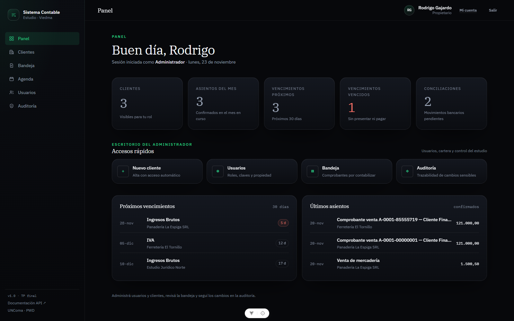
</p>

## Qué resuelve

Un estudio contable suele trabajar con planillas dispersas, correos y versiones que nadie sabe cuál es la vigente. Este sistema centraliza la operación diaria y deja trazabilidad de cada cambio:

- **Un lugar por cliente:** ficha, plan de cuentas, asientos, comprobantes, vencimientos y conciliación.
- **Contabilidad consistente:** partida doble validada en el backend, importes en `Decimal` y estados inmutables.
- **Trazabilidad:** historial de cambios de clientes, auditoría de acciones sensibles y numeración secuencial de asientos.
- **Portal del cliente:** cada empresa entra con su propio usuario y ve sólo su información.
- **Reportes listos para revisar:** diario, mayor, balance y libro IVA.

## Demo

`./dev.sh up` levanta el entorno y aplica migraciones; después, un comando carga los datos de ejemplo idempotentes:

```bash
./dev.sh up
podman exec sistema-contable-backend flask --app run.py seed-demo
```

Abrí **http://localhost:8080** e ingresá con cualquiera de estas cuentas:

| Rol | Email | Contraseña |
| --- | --- | --- |
| Propietario | `admin@estudio.com` | `Admin1234` |
| Contador | `contador.demo@estudio.com` | `ClaveSegura123` |
| Cliente | `cliente@estudio.com` | `Cliente1234` |
| Cliente | `cliente.espiga@estudio.com` | `Cliente1234` |

> Son credenciales públicas de demostración. Cambialas antes de cualquier despliegue real.

### Capturas

| | |
| --- | --- |
| 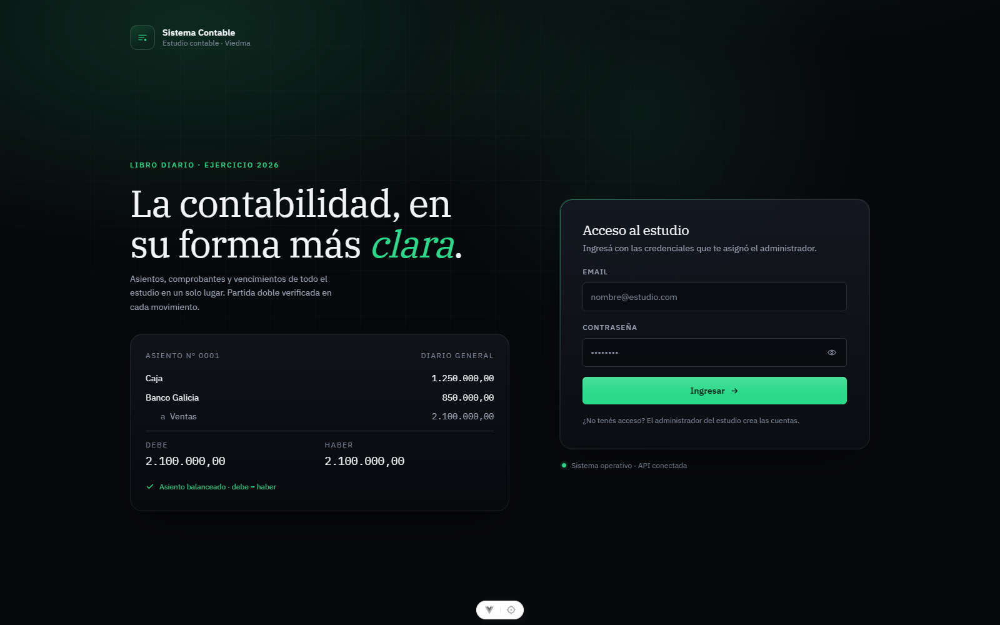 |  |
| Entrada (`/login`) | Panel del administrador |
| 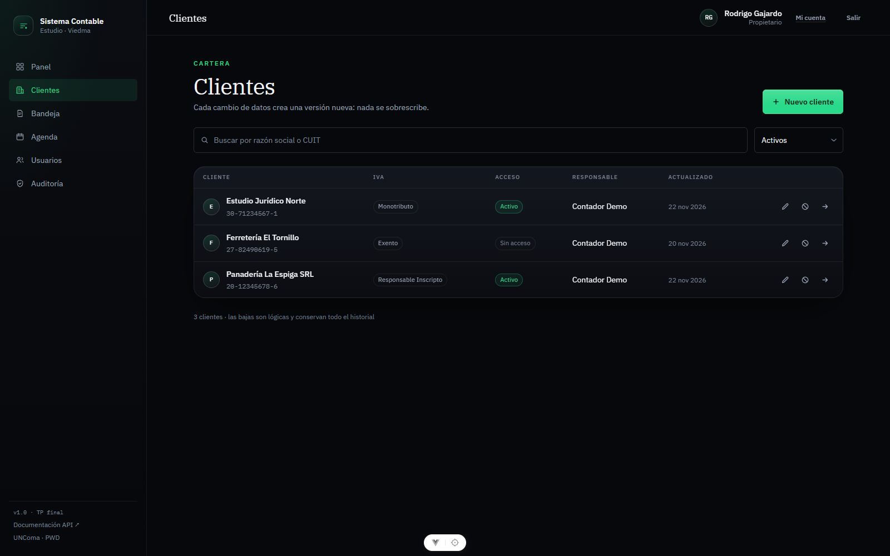 | 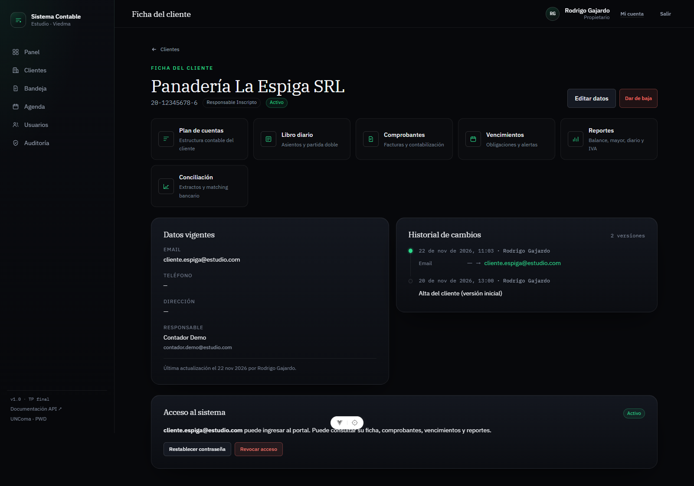 |
| Cartera de clientes | Ficha con historial versionado y acceso al portal |
| 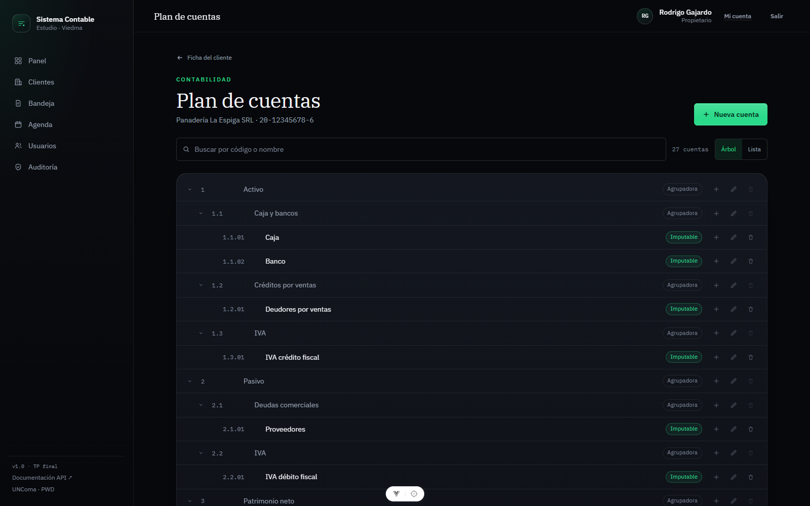 | 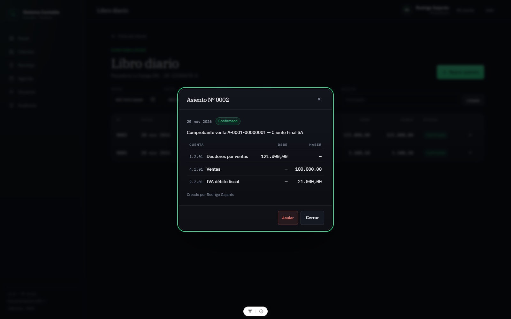 |
| Plan de cuentas jerárquico | Asiento con partida doble en vivo |
| 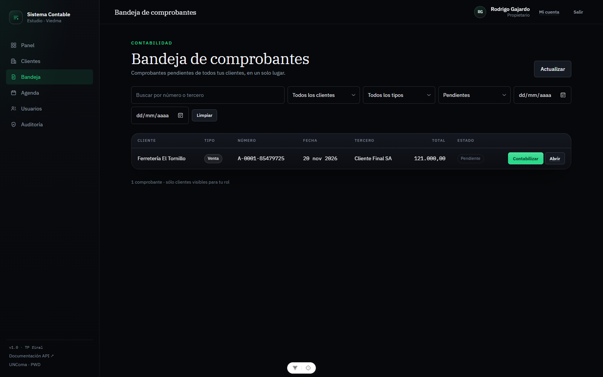 | 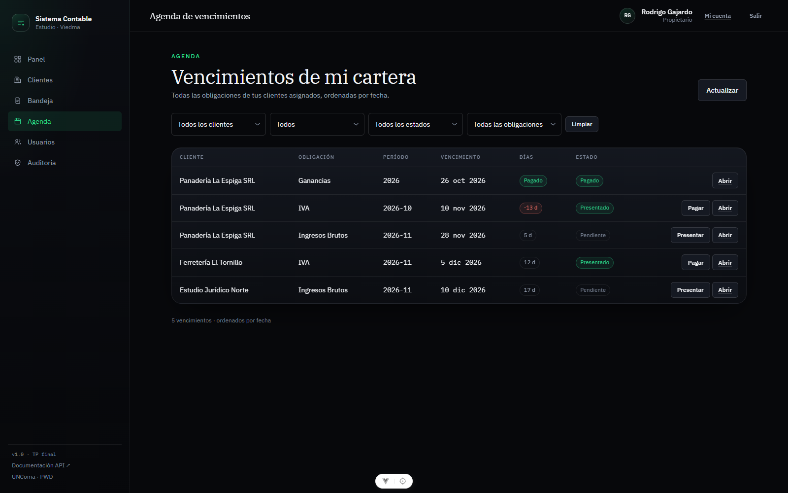 |
| Bandeja de comprobantes | Agenda de vencimientos |
| 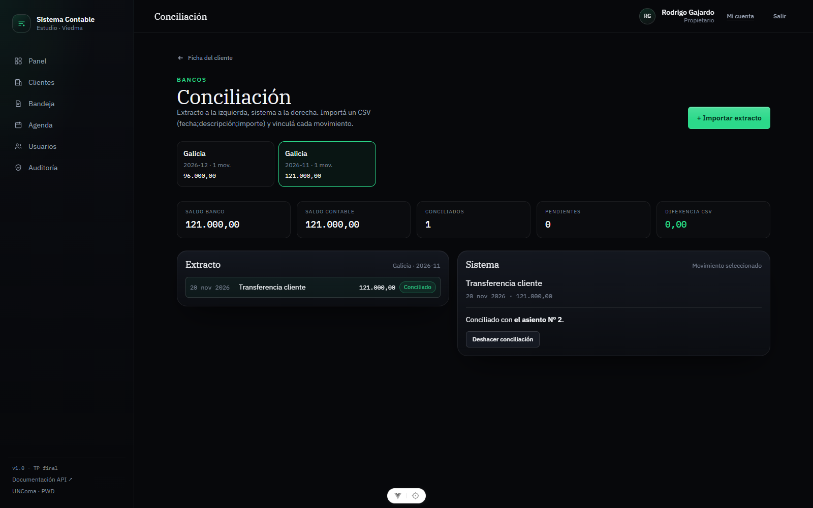 | 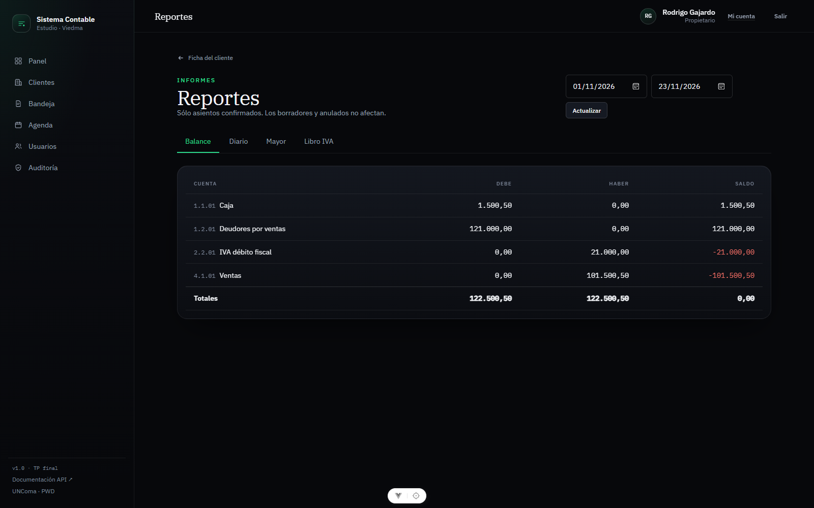 |
| Conciliación bancaria con matching | Reportes: balance, diario, mayor e IVA |
| 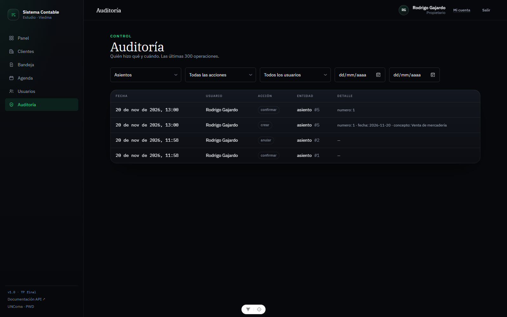 | 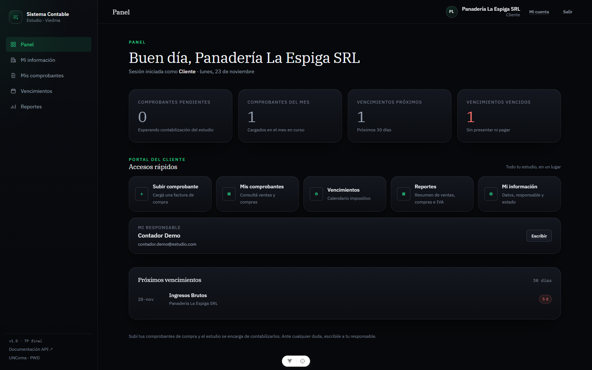 |
| Auditoría con antes/después (sólo admin) | Portal del cliente |
| 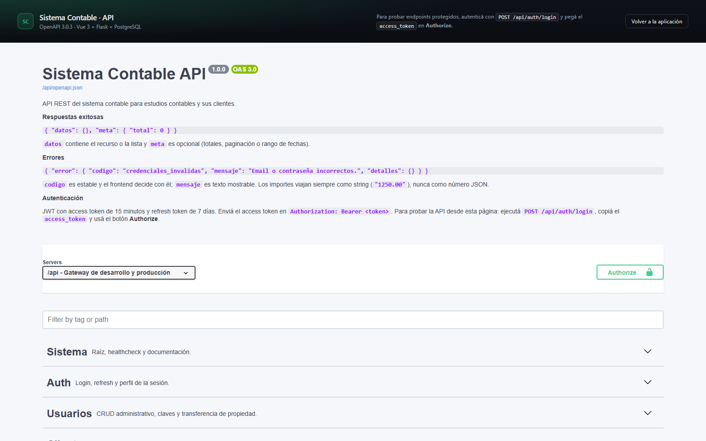 | |
| Documentación interactiva en `/api/docs` | |

> Las capturas se generan con datos de `seed-demo`; los nombres y comprobantes son ficticios.
> El procedimiento para regenerarlas está en [docs/capturas/README.md](docs/capturas/README.md).

La API está documentada con **OpenAPI 3.0.3** y Swagger UI en
**http://localhost:8080/api/docs** (también disponible en producción). Los
endpoints protegidos se prueban con el botón **Authorize** usando el
`access_token` de `POST /api/auth/login`.

## Roles

| Rol | Alcance |
| --- | --- |
| **Administrador** | Gestiona usuarios, clientes y la configuración del estudio. Ve todo y accede a la auditoría. |
| **Contador** | Opera sobre los clientes que tiene asignados. No ve carteras ajenas. |
| **Cliente** | Consulta su ficha, comprobantes, vencimientos y reportes. Puede subir comprobantes de compra. |

La seguridad se valida **siempre en el backend**. El frontend oculta botones por rol como mejora de experiencia, pero cada request se autoriza igual.

## Funcionalidades

| Módulo | Qué permite |
| --- | --- |
| **Usuarios** | Alta, edición, baja lógica, cambio de rol, reset de contraseña y transferencia de propiedad. |
| **Clientes** | Alta con CUIT validado, condición frente al IVA, contacto, contador responsable y acceso al portal. Historial completo de versiones. |
| **Plan de cuentas** | Árbol jerárquico por cliente, creación, edición y baja controlada. Plan base de 27 cuentas precargado. |
| **Asientos** | Libro diario con filtros, partida doble, numeración secuencial, confirmación y anulación con motivo. |
| **Comprobantes** | Facturas de compra y venta, cálculo de IVA, contabilización automática y anulación en cascada. |
| **Vencimientos** | Agenda de obligaciones impositivas con estados, próximos vencimientos y filtros. |
| **Conciliación bancaria** | Importación de extractos CSV, matching automático con puntaje de confianza, vinculación manual y generación de asientos. |
| **Reportes** | Diario, mayor, balance y libro IVA por rango de fechas. |
| **Auditoría** | Bitácora de cambios sensibles con filtros por entidad, acción, usuario y fecha. |
| **Dashboard** | KPIs de clientes, asientos del mes, comprobantes pendientes, vencimientos próximos y conciliaciones abiertas. |
| **API documentada** | OpenAPI 3.0.3 + Swagger UI en `/api/docs`, con ejemplos y autenticación Bearer. |

### Portal del cliente

- Usuario creado automáticamente al dar de alta el cliente.
- Contraseña temporal mostrada **una sola vez**, con vencimiento y cambio obligatorio en el primer ingreso.
- Acceso restringido a su propia ficha, comprobantes, vencimientos y reportes.
- Puede subir comprobantes de compra, que quedan pendientes para que el estudio los contabilice.

## Arquitectura

```
                     http://localhost:8080
                               │
                     ┌─────────▼─────────┐
                     │   nginx gateway   │
                     └────┬─────────┬────┘
                   /      │         │      /api/
               ┌──────────▼──┐   ┌──▼───────────┐
               │  frontend   │   │   backend    │
               │ Vue + Vite  │   │    Flask     │
               └─────────────┘   └──┬───────┬───┘
                                    │       │
                             ┌──────▼──┐  ┌─▼────────┐
                             │postgres │  │  redis   │
                             └─────────┘  └──────────┘
```

- **Una sola URL** (`:8080`) en desarrollo y en producción.
- En **desarrollo**, el gateway proxea a Vite (con HMR por WebSocket) y a Flask.
- En **producción**, el frontend *es* el gateway: nginx sirve el build estático y proxea `/api/`.
- **Redis** guarda los contadores de rate limiting. Es un servicio aparte porque con 2 workers de gunicorn un contador en memoria no sería confiable.
- **Postgres y Redis no publican puertos al host**: la base se accede exclusivamente desde el backend.

### Capas del backend

```
ruta (Blueprint) → controlador → servicio → modelo
```

- `models/`: entidades SQLAlchemy y relaciones.
- `schemas/`: validación de entrada y serialización con Marshmallow.
- `services/`: reglas de negocio, sin conocer `request`.
- `controllers/`: traducción HTTP ↔ servicios.
- `routes/`: un Blueprint por módulo.
- `docs/`: `openapi.yaml` y Swagger UI self-hosted; los sirve `routes/docs.py` en `/api/docs`.
- `utils/`: errores, decoradores de rol, seguridad y rate limiting.

## Stack

| Capa | Tecnología |
| --- | --- |
| Frontend | Vue 3 + Vite + Vue Router + Pinia + Axios (TypeScript) |
| Backend | Flask + SQLAlchemy + Flask-Migrate + Flask-JWT-Extended + Marshmallow |
| Seguridad | Argon2id (`argon2-cffi`), JWT con refresh, Flask-Limiter |
| Base de datos | PostgreSQL 17 |
| Cache / rate limiting | Redis 7 |
| Documentación de API | OpenAPI 3.0.3 + Swagger UI (self-hosted) |
| Gateway | nginx |
| Contenedores | Podman + `podman compose` (compatible con Docker) |

## API REST

Prefijo `/api`. La documentación interactiva está en **`/api/docs`**
(OpenAPI 3.0.3 + Swagger UI, self-hosted) y la especificación cruda en
**`/api/openapi.json`**. El test `tests/test_docs.py` verifica que todas las
rutas reales estén documentadas y que la spec sea válida.

Respuestas exitosas:

```json
{ "datos": {}, "meta": { "total": 0 } }
```

Errores:

```json
{ "error": { "codigo": "credenciales_invalidas", "mensaje": "Email o contraseña incorrectos.", "detalles": {} } }
```

| Módulo | Endpoints principales |
| --- | --- |
| Auth | `POST /auth/login`, `POST /auth/refresh`, `GET /auth/me` |
| Usuarios | `GET/POST /usuarios`, `GET/PUT/DELETE /usuarios/:id`, `POST /usuarios/:id/activar`, `PUT /usuarios/:id/password`, `POST /usuarios/:id/propietario` |
| Clientes | `GET/POST /clientes`, `GET/PUT/DELETE /clientes/:id`, `GET /clientes/:id/historial`, `POST /clientes/:id/acceso` |
| Cuentas | `GET/POST /clientes/:id/cuentas`, `GET/PUT/DELETE /cuentas/:id` |
| Asientos | `GET/POST /clientes/:id/asientos`, `GET/PUT/DELETE /asientos/:id`, `POST /asientos/:id/confirmar`, `POST /asientos/:id/anular` |
| Comprobantes | `GET/POST /clientes/:id/comprobantes`, `GET/PUT/DELETE /comprobantes/:id`, `POST /comprobantes/:id/contabilizar` |
| Vencimientos | `GET/POST /clientes/:id/vencimientos`, `PUT/DELETE /vencimientos/:id`, `POST /vencimientos/:id/estado` |
| Conciliación | `GET/POST /clientes/:id/extractos`, `DELETE /extractos/:id`, `PUT /movimientos/:id/vincular`, `POST /movimientos/:id/asiento` |
| Reportes | `GET /clientes/:id/reportes/{diario,mayor,balance,libro-iva}` |
| Auditoría | `GET /auditoria` |
| Dashboard | `GET /dashboard` |

## Puesta en marcha

### Requisitos

- Podman 5.x con `podman compose`
- `curl`
- En Windows: **Git Bash o WSL** para ejecutar `dev.sh`

### Desarrollo

```bash
./dev.sh up
podman exec sistema-contable-backend flask --app run.py seed-demo
```

El script verifica Podman, prepara los `.env` faltantes, construye las imágenes, levanta los servicios, refresca el gateway, aplica las migraciones y corre el seed.

| URL | Descripción |
| --- | --- |
| http://localhost:8080 | Aplicación |
| http://localhost:8080/api/ | Raíz de la API |
| http://localhost:8080/api/health | Healthcheck |
| http://localhost:8080/api/docs | Documentación interactiva (Swagger UI) |
| http://localhost:8080/api/openapi.json | Especificación OpenAPI 3.0.3 |

### Comandos

```bash
./dev.sh up            # construir, levantar, migrar y sembrar
./dev.sh down          # detener (conserva los datos)
./dev.sh restart       # reiniciar
./dev.sh logs          # seguir los logs
./dev.sh logs backend  # logs de un servicio (db, redis, backend, frontend, gateway)
./dev.sh status        # estado de contenedores + checks HTTP + ping a Redis
./dev.sh test          # pytest en el contenedor de desarrollo (~7 s)
./dev.sh test tests/test_clientes.py -q   # un archivo
./dev.sh check         # type-check + build del frontend
./dev.sh release       # imágenes prod + smoke test
./dev.sh reset         # recrear y reinstalar node_modules
```

## Cómo funciona el dominio

### Clientes versionados (append-only)

`clientes` guarda **sólo la identidad**: `id`, `cuit` (único e inmutable), `usuario_id` y `activo`. Los datos de negocio viven en `cliente_versiones`, que es append-only:

- Cada cambio inserta una fila completa con autor y fecha. **Nunca** se hace `UPDATE` de datos del cliente.
- Las lecturas toman la última versión de cada cliente (`max(id)` por cliente).
- Si el payload no cambia nada, no se crea una versión nueva.
- La ficha muestra el historial con el diff (`Condición IVA: Monotributo → Exento`) y quién lo hizo.

### Plan de cuentas

- Jerarquía por `padre_id`, con código único **por cliente**.
- Sólo las cuentas **imputables** reciben movimientos; las agrupadoras ordenan.
- Al crear un cliente se precarga un plan base de 27 cuentas (activo, pasivo, patrimonio, ingresos y egresos).
- Se valida que el padre sea del mismo cliente y que no se generen ciclos.
- Una cuenta con subcuentas o movimientos no se puede eliminar.

### Asientos y partida doble

- Estados: `borrador → confirmado → anulado`. Sólo el borrador se edita o se descarta; el confirmado se anula con motivo.
- Reglas: **debe = haber**, mínimo dos renglones, un solo lado por renglón, cuentas imputables/activas **del mismo cliente** y fecha no futura.
- Numeración secuencial por cliente con índice único; ante una carrera de números, el backend responde `409` y sugiere reintentar.
- Los importes viajan como **string** (`"1250.00"`): en JSON nunca se usan números para dinero. En Python son `Decimal`; en la base, `Numeric(14,2)`.

### Comprobantes y contabilización

- `total = neto + IVA` se calcula en el backend. El cliente no puede enviar `iva`, `total`, `estado` ni `asiento_id`: el schema los rechaza.
- Alícuotas admitidas: 0 %, 10,5 %, 21 % y 27 %.
- Contabilizar genera un asiento confirmado con las cuentas del plan base:
  - **Venta:** Debe *Deudores por ventas* / Haber *Ventas* + *IVA débito fiscal*.
  - **Compra:** Debe *Compras* + *IVA crédito fiscal* / Haber *Proveedores*.
- El comprobante y su asiento se crean en **una sola transacción**; si falta una cuenta, responde `409` indicando cuál.
- Anular el comprobante anula también su asiento, con el mismo motivo.

### Vencimientos

- Obligaciones impositivas por cliente y período, con estados `pendiente`, `presentado` y `pagado`.
- El dashboard muestra los próximos vencimientos y la agenda permite filtrar por cliente, estado y proximidad.

### Conciliación bancaria

- Importación de extractos en CSV con parseo de fechas e importes.
- Matching automático por **importe exacto** y fecha cercana (**±3 días**), con puntaje de confianza.
- Vinculación manual a un comprobante o asiento, desvinculación y descarte.
- Generación de un asiento desde un movimiento sin match.
- Reporte de saldo bancario, saldo contable y diferencia.

### Reportes y auditoría

- **Diario**, **mayor**, **balance** y **libro IVA** por rango de fechas.
- La auditoría registra usuario, acción, entidad, id, fecha y valores antes/después. Es de sólo lectura para el administrador.

## Seguridad

- **Argon2id** con parámetros de OWASP (`t=3`, `m=64 MiB`, `p=4`) y rehash transparente si cambian los parámetros.
- **Login genérico:** misma respuesta para email inexistente, usuario inactivo o contraseña incorrecta. Si el email no existe, se verifica contra un hash descartable para no filtrar la existencia por tiempo de respuesta.
- **Bloqueo por intentos:** 3 fallos por cuenta en 15 minutos → `429` con `Retry-After`. Se cuentan sólo los `401`, no los payloads inválidos. El contador vive en Redis y se comparte entre workers.
- **Límite por IP:** 30 fallos por 15 minutos, como red de seguridad contra fuerza bruta distribuida. La IP real se obtiene con `ProxyFix` + `X-Forwarded-For` de nginx.
- **JWT:** access token de 15 minutos y refresh token de 7 días (configurables por entorno). El frontend renueva de forma proactiva (30 s antes de vencer) y, ante un `401`, reintenta una vez.
- **Revocación:** cambiar la contraseña, dar de baja un usuario o revocar un acceso incrementa `token_version`; los JWT viejos quedan inválidos.
- **Bajas lógicas:** un usuario nunca se borra. Nadie puede desactivarse a sí mismo y el sistema no puede quedar sin un administrador activo.
- **Protección contra mass assignment** en comprobantes y reglas de propiedad de datos en todos los servicios.

## Calidad y tests

```bash
./dev.sh test     # suite completa (~7 s)
./dev.sh check    # type-check + build del frontend
./dev.sh release  # imágenes de producción + smoke test
```

- **126 tests** con pytest sobre SQLite en memoria y `limiter.reset()` en cada fixture.
- Cubren login genérico, Argon2id, refresh, bloqueo por intentos, permisos por rol, email duplicado, baja lógica, última cuenta admin, cambio de contraseña, CUIT, versionado de clientes, plan de cuentas, partida doble (estados, importes, multi-cliente), comprobantes (IVA, contabilización, anulación en cascada) y documentación de la API.
- En tests se baja el costo de Argon2 para que la suite sea rápida; en desarrollo y producción valen los defaults de OWASP.
- Migraciones Alembic versionadas y aplicadas en cada arranque de desarrollo.
- El `release` valida que la imagen de producción arranque con gunicorn y responda `/api/health`.

## Desarrollo

- **Hot reload del frontend:** Vite con HMR a través del gateway. Se usa `watch.usePolling` porque los bind mounts de Windows a WSL no emiten eventos del filesystem.
- **Hot reload del backend:** Flask en modo `--debug` con el código montado.
- **node_modules:** vive en un volumen de Linux. Después de tocar `package.json`, ejecutá `./dev.sh reset`.
- **Migraciones:** después de cambiar un modelo:

  ```bash
  podman exec sistema-contable-backend flask --app run.py db migrate -m "descripcion"
  ./dev.sh up
  ```

## Producción

```bash
cp infra/.env.example infra/.env.prod
cp backend/.env.example backend/.env.prod

podman compose --env-file infra/.env.prod \
  -f infra/compose.yaml -f infra/compose.prod.yaml \
  up -d --build
```

Las migraciones se aplican una vez contra la base:

```bash
podman exec sistema-contable-backend flask --app run.py db upgrade
podman exec sistema-contable-backend flask --app run.py seed
```

| | Desarrollo | Producción |
| --- | --- | --- |
| Frontend | Vite con HMR | nginx + build estático |
| Backend | `flask --debug` | gunicorn (2 workers) |
| Código | bind mounts | dentro de la imagen |
| Servicios | 5 (incluye gateway) | 4 |

## Variables de entorno

Cada entorno usa su propio archivo. **`.env.dev` se versiona** porque sólo contiene valores de desarrollo; **`.env.prod` nunca se versiona**.

| Archivo | Lo consume | Contenido |
| --- | --- | --- |
| `infra/.env.dev` | Compose (`--env-file`) | credenciales de Postgres y Redis |
| `backend/.env.dev` | Compose (`env_file`) | Flask, JWT, admin inicial, CORS |
| `frontend/.env.dev` | Vite (`--mode dev`) | `VITE_API_URL`, puertos de dev y HMR |

`DATABASE_URL` y `REDIS_URL` las construye Compose a partir de `infra/.env.*`, así las credenciales tienen una única fuente de verdad.

## Estructura

```
sistema_contable/
├── backend/
│   ├── app/
│   │   ├── models/          # entidades SQLAlchemy
│   │   ├── schemas/         # validación y serialización (Marshmallow)
│   │   ├── services/        # reglas de negocio (sin request)
│   │   ├── controllers/     # traducen HTTP <-> servicios
│   │   ├── routes/          # un blueprint por módulo
│   │   ├── docs/            # OpenAPI 3 + Swagger UI self-hosted
│   │   └── utils/           # errores, decoradores, seguridad, rate limit
│   ├── migrations/          # Alembic
│   └── tests/               # pytest
├── frontend/
│   ├── src/
│   │   ├── api/             # Axios + endpoints por módulo
│   │   ├── stores/          # Pinia (auth)
│   │   ├── router/          # rutas + navigation guards
│   │   ├── layouts/         # AppShell (sidebar + topbar)
│   │   ├── components/      # UI reutilizable
│   │   └── views/           # una vista por pantalla
│   └── DESIGN.md            # sistema de diseño
├── infra/
│   ├── compose.yaml         # definición común (postgres, redis, backend)
│   ├── compose.dev.yaml     # overlay de desarrollo (gateway + Vite)
│   ├── compose.prod.yaml    # overlay de producción
│   └── nginx/               # dev.conf (gateway) y nginx.conf (producción)
└── dev.sh                   # punto de entrada del entorno
```

## Limitaciones conocidas

- **Facturación electrónica:** no integra AFIP/ARCA; los comprobantes se registran manualmente.
- **Conciliación bancaria:** trabaja con importación CSV, sin conexión directa a bancos.
- **Un estudio por despliegue:** los clientes están aislados entre sí, pero no hay separación multi-estudio.
- **Tokens en `localStorage`:** es un trade-off de simplicidad. Para un entorno de alto riesgo conviene evaluar cookies `httpOnly` + CSRF.
- **Demo local:** las credenciales son públicas y los datos son de ejemplo.
- **CI:** la verificación es local (`./dev.sh test/check/release`); todavía no hay pipeline automatizado.

## Roadmap

- Integración con AFIP/ARCA para facturación electrónica.
- Notificaciones de vencimientos por email.
- Exportación de reportes a PDF y Excel.
- Rotación de refresh tokens y migración a cookies `httpOnly`.
- Soporte multi-estudio.
- CI/CD con despliegue automatizado.

## Documentación

- [Documentación de la API](http://localhost:8080/api/docs): Swagger UI con todos los endpoints y ejemplos.
- [Sistema de diseño](frontend/DESIGN.md): tokens, tipografía, movimiento y accesibilidad.

## Origen del proyecto

Este sistema nació como **Trabajo Final Integrador** de la Tecnicatura Universitaria en Desarrollo Web de la Universidad Nacional del Comahue. La versión que ves acá incluye tests automatizados, un entorno contenerizado de desarrollo y producción y mejoras de producto que amplían el alcance original de la materia.

Se mantiene como proyecto de portfolio y sigue en evolución.

## Licencia

© 2026. Todos los derechos reservados.

El código se publica como muestra de portfolio y para evaluación técnica. Si querés reutilizarlo o tenés una propuesta, abrí un issue.

## Problemas frecuentes

| Síntoma | Solución |
| --- | --- |
| `La máquina de Podman no responde` | `podman machine start` |
| `502 Bad Gateway` después de recrear el backend | nginx cachea la IP: `podman restart sistema-contable-gateway` (`./dev.sh up` ya lo hace) |
| El HMR no reconecta | Verificar `VITE_HMR_CLIENT_PORT=8080` en `frontend/.env.dev` |
| Cambios de `package.json` no se reflejan | `./dev.sh reset` |
| Puerto 8080 ocupado | `./dev.sh down` y revisar `podman ps` |
| `429` al probar el login | Es el bloqueo por intentos: esperar 15 min o liberar con `flask limiter clear` |
